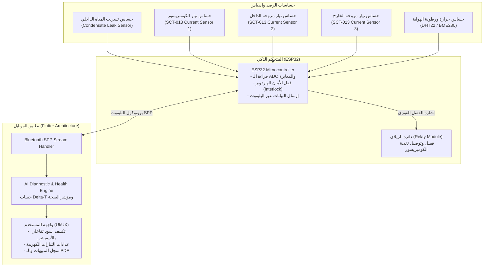

# دليل المناقشة والشرح الهندسي لمشروع التكييف الذكي (Smart HVAC)
## من الألف للياء: الفكرة، الدوائر، خوارزميات التشخيص، وتطبيق الموبايل

> [!IMPORTANT]
> هذا الدليل مكتوب باللغة الهندسية المبسطة "بالبلدي الفصيح" حتى تتمكن من شرح المشروع بثقة كاملة أمام أي دكتور، مهندس، أو لجنة تحكيم، مع حفظ كل مصطلح تقني بمكانه الصحيح.

---

## 1. الفكرة العامة للمشروع في 30 ثانية (The Elevator Pitch)

"إحنا عملنا نظام تحكم ومراقبة صحة تنبؤية لأجهزة التكييف الاسبليت (**Smart HVAC Condition Monitoring & Predictive Maintenance System**).
النظام مش مجرد ريموت بيشغل ويطفي التكييف بالموبايل؛ النظام عبارة عن **عقل إلكتروني** بيراقب 3 حاجات حيوية لحظة بلحظة:
1. **الأمان الإنشائي والكهربائي:** حماية من تنقيط المياه وطفح حوض الصرف الداخلي، مع فصل آمن فوري (Hardware Interlock).
2. **صحة الأجزاء الميكانيكية بالتيار الكهربائي:** مراقبة سحب الأمبير لـ 3 أجزاء رئيسية (الكومبريسور، مروحة الوحدة الداخلية، مروحة الوحدة الخارجية) لاكتشاف قفش البيلي، احتراق المواتير، أو ضعف الكاباستور قبل حدوث كارثة.
3. **الديناميكا الحرارية وكفاءة الفريون:** حساب فرق الحرارة الفيزيائي ($\Delta T$) بين هواء الغرفة وهواء التبريد الخارج، وربطه بسحب تيار الكومبريسور لكشف تسريب الفريون مبكراً وتوفير استهلاك الكهرباء."

---

## 2. المخطط الهندسي العام للمنظومة (System Architecture)



---

## 3. شرح الحساسات الـ 5 بالتفصيل والأعطال التي تكتشفها

| الحساس ومكانه | الإشارة الفيزيائية | العطل الهندسي المكتشف | الإجراء التلقائي |
| :--- | :--- | :--- | :--- |
| **1. حساس تسريب المياه**<br>*(في قاع حوض الوحدة الداخلية)* | كشف تراكم المياه الراكدة في حوض التكثيف (Conductivity / Float). | **انسداد خرطوم الصرف (Drain Pan Clogging):** أشهر عطل يتسبب في تنقيط مياه على الجدران وإتلاف الأثاث والدهانات. | فصل ريلاي الكومبريسور فوراً في جزء من الثانية (Hardware Lockout) ومنع التشغيل حتى جفاف الحساس. |
| **2. حساس تيار الكومبريسور**<br>*(SCT-013 على فازة الكومبريسور)* | سحب الأمبير الفعلي للضاغط ($I_{comp}$). | **• تيار عالي (> 8.0A):** قفش ميكانيكي (Locked Rotor) أو تلف كاباستور التقويم (Start Capacitor Failure).<br>**• تيار منخفض (< 3.2A):** انعدام حمل الغاز (تسريب فريون كامل). | إطلاق إنذار خطر فوري باللون الأحمر وخفض مؤشر الصحة إلى أقل من 50%. |
| **3. حساس تيار مروحة الداخل**<br>*(SCT-013 على موتور البلاور)* | سحب أمبير مروحة التبريد الداخلية ($I_{fan\_in}$). | **• تيار زائد (> 0.75A):** احتكاك بيلية الموتور (Bearing Friction) أو انسداد الفلاتر الشديد.<br>**• تيار منعدم (0A):** احتراق ملف الموتور أو انقطاع السلك. | إنذار صيانة تنبؤية لتغيير الموتور أو تشحيم البيلية قبل توقفه المفاجئ. |
| **4. حساس تيار مروحة الخارج**<br>*(SCT-013 على موتور المكثف)* | سحب أمبير مروحة الوحدة الخارجية ($I_{fan\_out}$). | **توقف مروحة المكثف:** يؤدي لارتفاع جنوني في ضغط الغاز العالي (High Head Pressure) مما يدمر الكومبريسور في دقائق. | إنذار عاجل لفحص الوحدة الخارجية وحماية الكومبريسور من التلف الحراري. |
| **5. حساس الحرارة والرطوبة**<br>*(على هواية خروج الهواء البارد)* | درجة حرارة الهواء المجهز ($T_{supply}$) ورطوبته. | حساب فرق درجات الحرارة الفيزيائي ($\Delta T$) ومراقبة كفاءة التبخير والتكثيف. | مدخل رئيسي لمعادلة كشف تسريب الفريون وحساب نقطة الندى (Heat Index). |

---

## 4. الخوارزمية الذكية: كيف يكتشف النظام تسريب الفريون رياضياً؟

الكومبريسور بيسحب غاز الفريون ويضغطه. 
* لو **الفريون مظبوط**: الكومبريسور عليه حمل ميكانيكي حقيقي، فيسحب أمبير طبيعي ($3.5\text{A} - 7.5\text{A}$)، ودرجة حرارة الهواء الخارج من الهواية بتكون منخفضة جداً بالمقارنة بحرارة الغرفة.
* لو **الفريون سرب**: الكومبريسور بيدور في "فراغ"، يعني مفيش مقاومة ولا ضغط، فسحب الأمبير يقل بشكل ملحوظ ($< 3.2\text{A}$)، والهواء الخارج ميبقاش بارد!

### المعادلة الهندسية في السوفتوير:
$$\Delta T = T_{return} - T_{supply}$$

* **الحالة الطبيعية (Optimal):**
  $$\Delta T \ge 9.0^\circ\text{C} \quad \text{AND} \quad I_{comp} \ge 3.5\text{A}$$
  $\rightarrow$ كفاءة التبريد ممتازة وشحنة الفريون مكتملة.

* **حالة تسريب الفريون (Low Refrigerant):**
  $$\Delta T < 7.0^\circ\text{C} \quad \text{AND} \quad (0.4\text{A} < I_{comp} < 3.2\text{A})$$
  $\rightarrow$ إطلاق إنذار **WARNING: Potential Freon Leak**، وتنبيه الفني بوجود تسريب قبل أن يحترق الكومبريسور من السخونة الزائدة.

---

## 5. بروتوكول نقل البيانات عبر البلوتوث (Communication Protocol)

الميكروكنترولر ESP32 مبرمج يبعت سطر بيانات منظم كل نصف ثانية عبر البلوتوث التسلسلي (Bluetooth Serial SPP):

```text
T:24.5,H:55.0,W:0,C:5.4,FI:0.38,FO:0.85\n
```

* `T` = درجة حرارة الهواية (Temperature)
* `H` = رطوبة الهواية (Humidity)
* `W` = حالة حساس المياه (0 = سليم، 1 = تسريب طارئ)
* `C` = تيار الكومبريسور بالأمبير
* `FI` = تيار مروحة الداخل (Fan Indoor)
* `FO` = تيار مروحة الخارج (Fan Outdoor)

> [!TIP]
> الكود مصمم بنظام **Backward Compatibility**؛ يعني لو جهاز أقدم بعت فقط `T:25,H:60,W:0`، التطبيق بيفهم ويشتغل طبيعي بدون أي Crash.

---

## 6. تصميم التطبيق والواجهة (Flutter Architecture & UI)

1. **إدارة الحالة (State Management):**
   * استخدام `Provider` لضمان تحديث الواجهة اللحظي بدون أي تهنيج أو إعادة بناء غير لازمة (Reactive UI).
2. **اللمسة الجمالية (Premium Off-White Theme):**
   * تم استخدام خلفية عاجية بريميوم (`#F8FAFC`) بدلاً من الأبيض الصريح المجهد للعين.
   * تصميم تكييف أسود فخم (Glossy Jet-Black Unit) بيلمع ويعرض الحرارة رقمياً مع موجات هواء بارد تفاعلية متزامنة مع تشغيل وإيقاف الريلاي الحقيقي.
3. **التشخيصات ولوحة القيادة (Diagnostics Screen):**
   * مؤشر صحة دائري تفاعلي (Radial Gauge) من 0 إلى 100%.
   * بطاقات مستقلة للتيارات الكهربية بخط ديجيتال أوربيترون (Orbitron Font) لتبدو كأجهزة قياس المختبرات.

---

## 7. أهم أسئلة لجان التحكيم والدكاترة المتوقعة وكيفية الرد عليها

### س1: "ليه ركبتوا حساسات تيار مش مجرد حساس حرارة؟"
> **الإجابة النموذجية:**  
> "حساس الحرارة بطيء في الاستجابة (Thermal Inertia) ومش بيكتشف غير العطل بعد ما يحصل. لكن حساس التيار بيرصد الخلل الكهربائي والميكانيكي اللحظي (Electrical Transients) في جزء من الثانية؛ يعني لو الكومبريسور قفش (Locked Rotor) أو الكاباستور ضرب، التيار بيقفز فوراً لـ 10 أمبير، ونقدر نفصل الدائرة وننقذ الكومبريسور اللي تمنه آلاف الجنيهات قبل ما ملفاته تتحرق."

### س2: "ليه اعتمدتوا على البلوتوث مش الـ Wi-Fi؟"
> **الإجابة النموذجية:**  
> "البلوتوث SPP بيوفر اتصال مباشر (Peer-to-Peer) ومستقر جداً في الموقع بدون الاعتماد على راوتر إنترنت أو شبكة خارجية قد تنقطع في الورش أو المنازل، بالإضافة لاستهلاك طاقة منخفض وسرعة استجابة فورية لأوامر الطوارئ (Low Latency Control)."

### س3: "لو التكييف سرب مياه، هل بتعتمدوا على الموبايل عشان يفصل؟"
> **الإجابة النموذجية:**  
> "إطلاقاً يا فندم! الموبايل للمراقبة فقط في حالات الطوارئ. لكن كود الـ ESP32 نفسه مبرمج فيه قفل أمان هاردوير (Hardware Interlock) داخلي؛ بمجرد ما قطرة مياه تلمس حساس الحوض، الـ ESP32 بيفصل ريلاي التكييف فوراً وبيرفض تشغيله برمجياً حتى يجف الحوض تماماً، وده بيضمن سلامة المكان حتى لو الموبايل مقفول أو البلوتوث مفصول."

### س4: "إيه الفرق بين النظام ده والتكييفات الذكية التجارية (Smart Inverters)؟"
> **الإجابة النموذجية:**  
> "التكييفات التجارية مغلقة المصدر (Proprietary Black Box) ولا تتيح للمستخدم أو الفني معرفة التيارات الفعلية أو كفاءة الفريون ونسبة انسداد الصرف، وغالباً بتكتفي بلمبة حمراء تطفي الجهاز بعد وقوع الضرر. نظامنا **Retrofit Solution** مفتوح المصدر وقابل للتركيب على أي تكييف اسبليت قديم أو جديد بتكلفة اقتصادية، وبيقدم صيانة تنبؤية حقيقية (Predictive Maintenance) بتحدد العطل بالاسم ورقم الجزء الميكانيكي."
