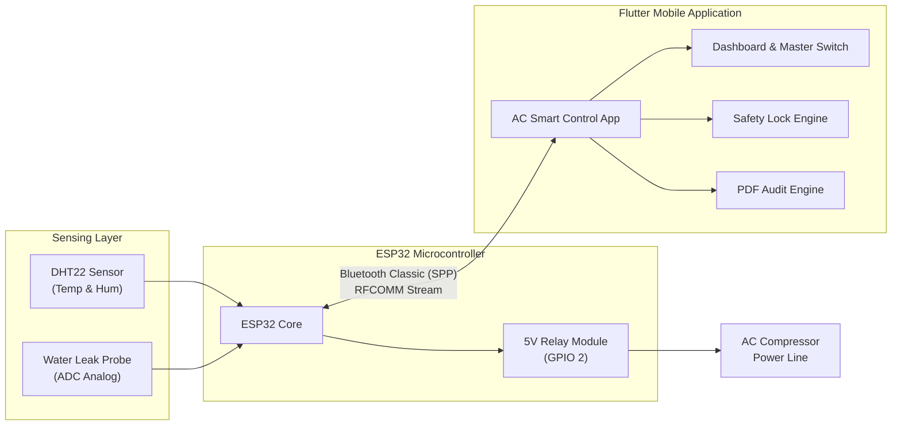

# ❄️ AC Smart Control & Leakage Safety System

[](https://flutter.dev)
[](https://dart.dev)
[](https://www.espressif.com/)
[](LICENSE)
[](https://www.android.com)

A professional, commercial-grade IoT Climate & Air Conditioning Management System. Connects an **ESP32** microcontroller over **Bluetooth Classic (RFCOMM / SPP)** with a modern **Flutter mobile application**, featuring real-time environmental monitoring, smart safety hardware interlocks, water leakage detection, and automated engineering PDF reporting.

**Supervised & Approved by:** `Eng. Mahmoud Zayed`

---

## 📸 Key Features

- **🎨 Minimalist Light Design (Human-Crafted):** Designed following Apple Home & Google Nest aesthetic standards. Clean slate typography, crisp card elevations, and soft atmospheric gradients.
- **⚡ Real-time Telemetry:** Instant live telemetry for Temperature (°C), Relative Humidity (%), and Heat Index.
- **🚨 Condensate Leakage Monitoring & Safety Interlock:** 3-tier water monitoring (`Normal`, `Warning`, `Critical`). If condensate overflows, the AC compressor is **automatically cut off** in both firmware and mobile app to protect the facility.
- **🔘 Direct Master AC Power Switch:** Single-tap compressor control (`START AC` / `STOP AC`) directly from the home dashboard.
- **📑 Automated Engineering PDF Audit:** Multi-page A4 incident and telemetry report generator with statistical summaries, signed by **Eng. Mahmoud Zayed**.
- **🧪 Offline Demo Mode:** Built-in sensor simulation engine for live presentations without physical hardware.

---

## 🏛️ System Architecture



---

## 🔌 Hardware Pinout & Wiring

| Component | ESP32 Pin | Details |
| :--- | :---: | :--- |
| **DHT22 Data Pin** | `GPIO 4` | Digital Input (with 10kΩ pull-up resistor) |
| **Water Leak Sensor** | `GPIO 34` | Analog Input (ADC1) |
| **5V Relay Control** | `GPIO 2` | Active-HIGH Digital Output (Controls AC compressor) |
| **VCC / GND** | `3.3V / 5V / GND` | Regulated power rails |

---

## 📡 Serial Communication Protocol

The mobile app and ESP32 exchange lightweight newline-delimited (`\n`) ASCII packets over Bluetooth Classic SPP:

### ESP32 ➡️ Mobile App:
```text
T:24.5,H:58.0,W:0\n
```
* `T:<float>` — Ambient room temperature in Celsius.
* `H:<float>` — Relative humidity percentage.
* `W:<int>` — Condensate tank status:
  * `0` = **Normal Safe** (0% - 40%)
  * `1` = **Warning** (40% - 75%)
  * `2` = **Critical Leakage** (75% - 100%) ➡️ *Forces AC Shutdown*

### Mobile App ➡️ ESP32:
* `AC:ON\n` — Command to energize the compressor relay.
* `AC:OFF\n` — Command to cut off the compressor relay.

---

## 📂 Repository Structure

```text
ac_smart_control/
├── android/                   # Native Android configuration & manifest
├── firmware/                  # Microcontroller firmware
│   └── esp32_ac_smart/
│       └── esp32_ac_smart.ino # Production Arduino C++ firmware for ESP32
├── lib/
│   ├── models/
│   │   └── sensor_data.dart   # Reactive state management & safety interlocks
│   ├── screens/
│   │   ├── splash_screen.dart          # Minimalist 2.4s branding intro
│   │   ├── main_navigation_screen.dart # Floating navigation shell & status bar
│   │   ├── dashboard_screen.dart       # Live gauges & master power controls
│   │   ├── ac_control_screen.dart      # Detailed climate & relay monitor
│   │   ├── water_level_screen.dart     # Condensate reservoir visualizer
│   │   ├── bluetooth_screen.dart       # Classic SPP discovery & auto-connect
│   │   └── archive_screen.dart         # Historical log & PDF export
│   ├── services/
│   │   ├── bluetooth_service.dart      # Robust SPP stream & auto-reconnect
│   │   └── pdf_service.dart            # A4 engineering audit report engine
│   ├── theme/
│   │   └── app_theme.dart     # Modern light aesthetic palette (Plus Jakarta Sans)
│   ├── widgets/
│   │   └── widgets.dart       # Modern gauges, reservoirs, and pills
│   └── main.dart              # Application entry point & system UI setup
├── pubspec.yaml               # Flutter package dependencies
└── README.md                  # Project documentation
```

---

## 🚀 Getting Started

### 1. Prerequisites
- **Flutter SDK:** `>= 3.47.0`
- **Android Studio / VS Code** with Flutter extensions
- **Arduino IDE** (with ESP32 board package installed)

### 2. Flashing the ESP32
1. Open `firmware/esp32_ac_smart/esp32_ac_smart.ino` in Arduino IDE.
2. Select **ESP32 Dev Module** from `Tools` > `Board`.
3. Install required libraries: `DHT sensor library` by Adafruit.
4. Upload to ESP32.

### 3. Running the Flutter App
```bash
# Clone the repository
git clone https://github.com/hassanIssa00/AC-Smart-Control.git
cd AC-Smart-Control

# Install dependencies
flutter pub get

# Run on connected Android device
flutter run --release
```

### 4. Building the Production APK
```bash
# Generate architecture-split Release APKs (~17 MB)
flutter build apk --release --split-per-abi
```

---

## 👨‍💻 Engineering & Authorship

- **Project Lead & Developer:** Hassan Issa
- **Engineering Supervision:** Eng. Mahmoud Zayed
- **Project Domain:** Smart Buildings, Embedded IoT, Climate Automation

---

## 📄 License
This project is licensed under the MIT License - see the [LICENSE](LICENSE) file for details.
