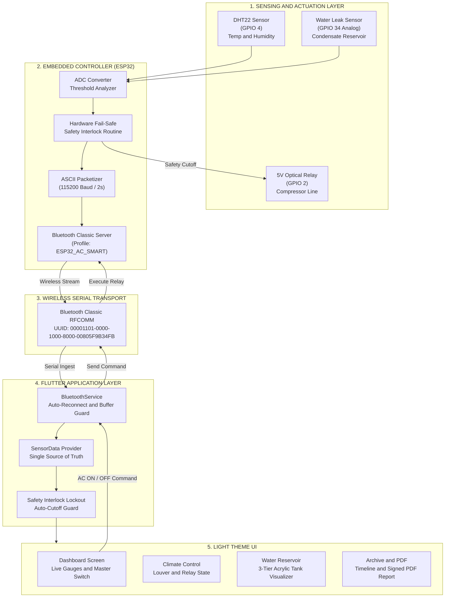
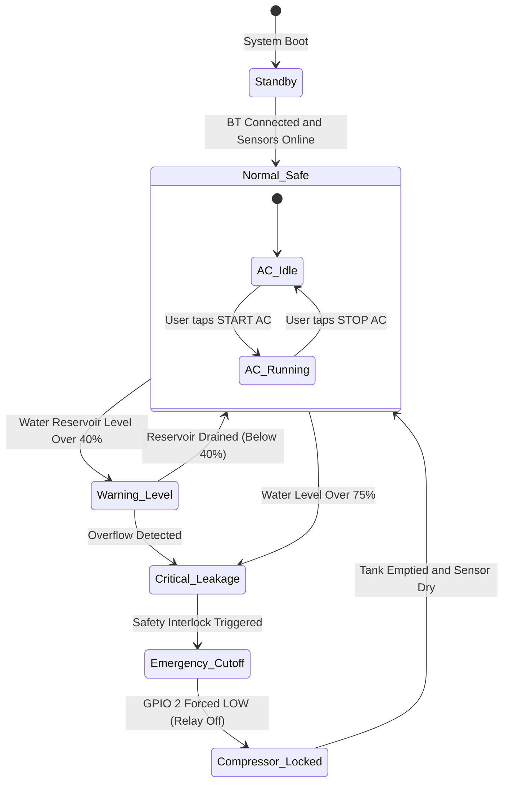
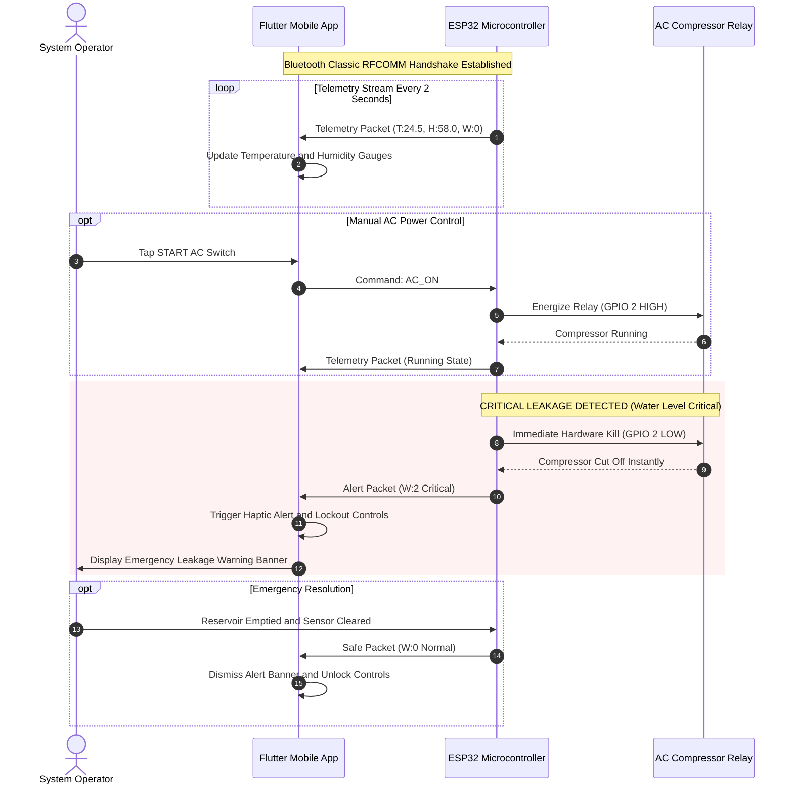
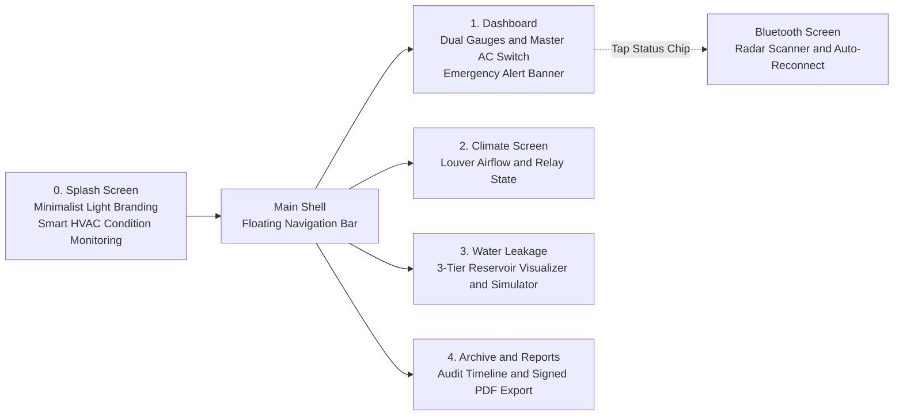

# ❄️ ClimaSmart — AC Smart Control & Leakage Protection System

<p align="center">
  
  
  
  
  
  
</p>

---

## 📌 Project Overview

**ClimaSmart** is an enterprise-grade IoT climate monitoring and automated protection system designed for residential and commercial split air conditioning units. It combines an **ESP32 microcontroller** with a human-centric, **light-themed Flutter mobile application** over **Bluetooth Classic (RFCOMM / SPP)**.

The system addresses the critical problem of **unnoticed condensate drainage failure and water overflow leakage** from split AC units by implementing a real-time fail-safe hardware interlock:
1. Continuous ambient temperature & humidity telemetry from the AC airflow stream.
2. Analog condensate reservoir & leak sensor monitoring (3-tier state analysis).
3. **Automated Safety Interlock:** Automatic emergency compressor shutdown upon critical leakage detection to prevent building and interior damage.
4. One-touch master compressor relay switching directly from the mobile dashboard.
5. Automated multi-page A4 engineering PDF telemetry report generation.

**Engineering Project:** `Smart HVAC Condition Monitoring & Control`  
**System Architecture & Development:** `Hassan Issa`

---

## 🏛️ Comprehensive System Architecture



---

## 🛡️ Safety State Machine & Auto-Cutoff Logic

The following state machine governs both the **ESP32 embedded firmware** and the **Flutter mobile application** to guarantee that the AC compressor cannot run when water overflow or leakage is detected.



---

## 🔄 Bidirectional Communication Protocol & Sequence



---

## 🔌 Hardware Schematics & Pin Mapping

```text
       +-------------------------------------------------------+
       |                  ESP32 DEVKIT V1                      |
       |                                                       |
       |  [GPIO 4]  -------------------> DHT22 Data Pin        |
       |  [GPIO 34] <------------------- Water Leak Analog Out |
       |  [GPIO 2]  -------------------> Relay Signal (IN)     |
       |  [3.3V]    -------------------> DHT22 VCC             |
       |  [VIN/5V]  -------------------> Relay VCC             |
       |  [GND]     -------------------> Common System Ground  |
       +-------------------------------------------------------+
                                  |
                                  | High-Voltage AC Side
                                  v
       +-------------------------------------------------------+
       |               5V OPTICAL RELAY MODULE                 |
       |  [NO] (Normally Open) ---> AC Compressor Live Wire    |
       |  [COM] (Common)       ---> 220V Mains Live Source     |
       +-------------------------------------------------------+
```

| Subsystem | Component | ESP32 Pin | Logic Level | Operating Purpose |
| :--- | :--- | :---: | :---: | :--- |
| **Airflow Climate** | DHT22 (AM2302) | `GPIO 4` | 3.3V Digital | Precision ambient temperature (±0.5°C) & relative humidity (±2%) |
| **Leak Detection** | Analog Water Probe | `GPIO 34` | 0 - 3.3V Analog | Multi-level condensate accumulation measurement via ADC1 |
| **Power Control** | 5V Optocoupler Relay | `GPIO 2` | 3.3V / 5V Active HIGH | Cuts live line to the AC compressor contactor coil |
| **Telemetry Bus** | Serial Bluetooth | Internal | 2.4 GHz RFCOMM | High-throughput bi-directional SPP serial stream |

---

## 🎨 User Interface Sitemap & Screen Flow



---

## 📦 Data Packet Specification

Packets are transmitted continuously every **2000 milliseconds** using comma-delimited key-value ASCII strings:

```text
T:24.5,H:58.0,W:0\n
```

| Parameter | Identifier | Type | Range | Meaning |
| :---: | :---: | :---: | :---: | :--- |
| **Temperature** | `T` | `float` | `-40.0` to `80.0` | Room temperature in Celsius (°C) |
| **Humidity** | `H` | `float` | `0.0` to `100.0` | Air relative humidity percentage (%) |
| **Water State** | `W` | `int` | `0`, `1`, `2` | `0` = Normal Safe \| `1` = Warning \| `2` = Critical Leakage |
| **Delimiter** | `\n` | `char` | ASCII `0x0A` | Frame termination byte for buffer synchronization |

---

## 💻 Tech Stack & Dependencies

| Layer | Technology | Version | Purpose |
| :--- | :--- | :---: | :--- |
| **Mobile Framework** | [Flutter](https://flutter.dev) | `3.47.8` | Cross-platform high-performance UI engine |
| **Programming Language** | [Dart](https://dart.dev) | `3.13.7` | Sound null-safe reactive application logic |
| **State Management** | `provider` | `^6.1.2` | Scalable `ChangeNotifier` reactive state binding |
| **Bluetooth Classic** | `flutter_blue_classic` | `^0.1.1` | Native Android RFCOMM/SPP driver (Gradle 8+ compatible) |
| **Document Reporting** | `pdf` & `printing` | `^3.13.1` / `^5.15.1` | Native vector-based multi-page A4 PDF rendering |
| **Permissions** | `permission_handler` | `^11.3.1` | Android 12+ runtime Bluetooth and Location grants |
| **Typography** | `google_fonts` | `^6.2.1` | Clean, modern Plus Jakarta Sans typography |
| **Animations** | `flutter_animate` | `^4.5.0` | 60fps micro-interactions, fades, and warning alerts |
| **Microcontroller Core** | [Arduino ESP32 Core](https://github.com/espressif/arduino-esp32) | `>= 2.0.0` | Native C++ FreeRTOS embedded environment |

---

## 🚀 Installation & Deployment

### 1. Flash the ESP32 Microcontroller
1. Install [Arduino IDE](https://www.arduino.cc/en/software) with the **ESP32 Board Package**.
2. Install the **DHT sensor library** (Adafruit) via Library Manager.
3. Open `firmware/esp32_ac_smart/esp32_ac_smart.ino`.
4. Select your board (`ESP32 Dev Module`) and COM port.
5. Click **Upload**. Open Serial Monitor at **115200 baud** to verify startup.

### 2. Build the Flutter Application
```bash
# 1. Clone the repository
git clone https://github.com/hassanIssa00/AC-Smart-Control.git
cd AC-Smart-Control

# 2. Fetch Flutter package dependencies
flutter pub get

# 3. Connect Android device with USB Debugging enabled
flutter devices

# 4. Run the application
flutter run --release
```

### 3. Generate Minimalist Production APK
```bash
# Produces architecture-split release APKs (~17 MB each)
flutter build apk --release --split-per-abi
```
Built APK location: `build/app/outputs/flutter-apk/app-arm64-v8a-release.apk`

---

## 📑 Automated Engineering PDF Report

The built-in PDF service generates a professional, high-resolution engineering report containing:
- Formal incident audit metadata (device MAC, export timestamp, operator ID).
- Color-coded KPI summary cards (Avg Temperature, Peak Temperature, Leak Incident Count).
- Complete chronologically ordered tabular telemetry history.
- Verification badge: **Automated Cryptographic Certification & Official Audit Log**.

---

## 👨‍💻 Project Authors & Credits

* **System Design & Implementation:** Hassan Issa ([@hassanIssa00](https://github.com/hassanIssa00))
* **Repository:** [https://github.com/hassanIssa00/AC-Smart-Control](https://github.com/hassanIssa00/AC-Smart-Control)
* **Direct APK Downloads:** [Releases Page](https://github.com/hassanIssa00/AC-Smart-Control/releases/tag/v1.0.0)

---

## 📄 License

This project is licensed under the MIT License — see the [LICENSE](LICENSE) file for full details.
